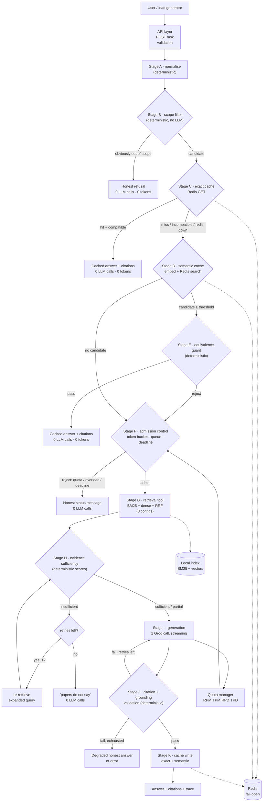

# IMPLEMENTATION PLAN — The Relay

Status: **Phase 0 complete (audit). Phase 1 designed, awaiting approval.**
Companion: `ASSIGNMENT_REQUIREMENTS.md`. History: `PROJECT_JOURNAL.md`.

---

## 1. What problem are we actually solving?

Not "build a chatbot". The brief describes a *service under contention*:

- Requests arrive in **bursts**.
- Most need **several steps**; a few **loop**.
- The provider limits **requests/min, tokens/min, requests/day** — and those limits, verified
  today, are **RPM 30, TPM 8,000, RPD 1,000, TPD 200,000** for the free tier.
- Tools time out; some calls are **slow for no visible reason**; some **succeed slowly instead
  of failing quickly**.
- Users **give up sooner than you expect**.

And four goals that cannot all be satisfied: *fast, good, cheap, nobody turned away.*
The assignment's real question is: **which one do you give up, when, and can you prove it?**

So the deliverable is not the pipeline. It is the pipeline **plus a measurement apparatus**
that makes every trade-off sayable in one sentence backed by a row in `results.csv`.

---

## 2. The one decision that shapes everything

> **TPM (8,000 tokens/minute) and TPD (200,000 tokens/day) bind long before RPM (30).**

Consequences, all of which fall out of that single fact:

1. **Caching is the primary cost control**, not batching or prompt trimming. A repeated
   question costs ~1,000 tokens = ~12 % of a whole minute's budget. Serving it from Redis is
   worth more than any micro-optimisation.
2. **The system must schedule tokens, not requests.** A token bucket on TPM, not a
   request counter, is the correct admission gate.
3. **Context must be small.** 8k TPM forces hard limits on retrieved context. "Extensive"
   retrieval cannot mean "stuff 8 chunks in" — it has to mean *better* chunks, not *more*.
4. **A second LLM verification call costs 100 % more tokens.** It must be off by default
   until measured otherwise.
5. **Daily budget exhaustion is a real, reachable state**, not a theoretical one — ~200
   answers/day at 1,000 tokens each. That is why heading 5 and heading 7 of the brief exist.

This is the number the report should lead with, and it is *not* guessable from the docs alone:
the docs list RPM 30 first, which makes requests look like the scarce resource. **They are not.**

---

## 3. Architecture

### 3.1 Shape

A **modular monolith**. One process, one Redis, no message broker. The brief asks for a
"small working version"; adding services would buy nothing measurable and cost days of glue.

### 3.2 Component diagram



### 3.3 Data flow, stage by stage

| Stage | Input | Output | LLM? | Tokens? | Deterministic? | Can fail alone? | Affects |
|---|---|---|---|---|---|---|---|
| A normalise | raw question | normalised question + preserved features (numbers, negation, entities) | no | no | **yes** | no | cost, quality |
| B scope filter | normalised question | `in_scope` / `out_of_scope` + reason | no | no | **yes** | no | cost, quality |
| C exact cache | key | hit/miss + entry | no | no | yes (Redis is not) | **yes** | cost, latency |
| D semantic cache | embedding | candidates + scores | no | no | no (approx) | **yes** | cost, latency, **quality** |
| E equivalence guard | candidate + question | accept/reject + reason | no | no | **yes** | no | **quality** |
| F admission | token estimate, deadline | admit / queue / reject | no | no | **yes** | no | latency, reliability |
| G retrieval | query, config | ranked chunks + scores | no | no | yes | yes | quality, latency |
| H evidence | chunks + query | sufficient / partial / insufficient / conflicting | no | no | **yes** | no | **quality** |
| I generation | prompt + chunks | answer text, streamed | **yes** | **yes** | no | **yes** | quality, cost, latency |
| J validation | answer + chunks | grounded? citations valid? | no (LLM optional, off) | no | **yes** | no | **quality** |
| K cache write | validated answer | cache entry | no | no | yes | yes (ignored) | cost |

**Only stage I consumes tokens.** Everything else is local. That is the cost story.

### 3.4 Failure isolation

Each stage degrades independently:

- Redis down → cache stages become no-ops, pipeline continues, trace says `cache_degraded`.
- Embedding model unavailable → semantic cache disabled, dense retrieval falls back to BM25.
- Groq 429 → admission control absorbs it; request may be delayed, downgraded, or honestly refused.
- Retrieval returns nothing → evidence gate refuses instead of hallucinating.
- Generation times out → bounded retry, then an honest timeout message.

---

## 4. Proposed repository layout

```
P:\ProjectRelay\
├── the_relay/
│   ├── config.py               # every knob, typed, one place
│   ├── main.py                 # CLI entrypoint: ask / ingest / eval / load / report
│   ├── api/            routes.py, schemas.py          # thin HTTP layer
│   ├── core/           normalize.py, scope.py, quota.py,
│   │                   admission.py, retry.py, pipeline.py
│   ├── rag/            ingest.py, chunking.py, embeddings.py,
│   │                   index.py, retrieval.py, evidence.py,
│   │                   generation.py, citations.py
│   ├── cache/          base.py, redis_store.py, exact.py,
│   │                   semantic.py, guard.py, keys.py
│   ├── providers/      base.py, groq.py, standin.py
│   ├── eval/           dataset.py, grader.py, metrics.py
│   ├── experiments/    probe.py, loadgen.py, scenarios.py
│   └── obs/            traces.py, results_csv.py
├── documents/          # the 3 pinned PDFs
├── indexes/            # built artifacts (git-ignored)
├── tests/
├── scripts/
├── logs/               # request_traces.jsonl, model_calls.jsonl, cache_traces.jsonl
├── results/            # results.csv + per-scenario raw JSONL
├── reports/            # REPORT.md
├── config/             # retrieval.yaml, standin_calibration.json, corpus_manifest.json
├── docs/conversation/  # verbatim assistant history (R48)
├── .env.example  .gitignore  requirements.txt  README.md
├── ASSIGNMENT_REQUIREMENTS.md  IMPLEMENTATION_PLAN.md
├── PROJECT_JOURNAL.md  LIVE_DISCUSSION_PREP.md
```

---

## 5. RAG design

### 5.1 Ingestion

1. Read PDF with `pypdf`, page by page.
2. **Strip running headers/footers** (detect lines repeated on ≥30 % of pages). *Required —
   the Moshi PDF repeats its title on ~every page (verified during audit).*
3. **Re-hyphenate** words broken across lines; normalise ligatures and Unicode.
4. Detect numbered section headings (`3.2 Attention`) and carry the current section forward.
5. Emit one JSONL record per page with `{doc_id, title, arxiv_id, version, page, section, text}`.
6. Chunk **within** page boundaries so every chunk has an unambiguous page number.

Why page-bounded chunking: the brief demands citations "where in the papers". A chunk that
spans pages 4–5 makes "page 4 or 5?" a guess. Splitting at page boundaries costs a little
context continuity and buys *verifiable* citations. That is the right trade.

### 5.2 Chunking

Recursive split on paragraph → sentence → word, targeting `chunk_tokens` with `overlap_tokens`.
Chunk size is a Table-3 axis, so it is a config value with three presets:

| Preset | chunk_tokens | overlap | top_k | rerank | Intent |
|---|---|---|---|---|---|
| `light` | 700 | 60 | 3 | no | fewest tokens, fastest |
| `balanced` | 450 | 80 | 5 | yes | default |
| `extensive` | 300 | 120 | 9 | yes | best coverage, most tokens |

Note the counter-intuitive part: `extensive` uses **smaller** chunks and a bigger `k`. With an
8k TPM wall you cannot afford more context, so "more thorough" must mean *more precise
granules*, not *more text*. This hypothesis is exactly what Table 3 will test — and it may be
wrong, which is a legitimate result.

### 5.3 Embeddings

- Local, ONNX, CPU: `fastembed` + `BAAI/bge-small-en-v1.5` (384-d).
- **Why not sentence-transformers:** ~2.5 GB torch install on Windows for a job a 130 MB ONNX
  model does in milliseconds. No API cost either way.
- Vectors are normalised; similarity = cosine = dot product.

### 5.4 Retrieval

Hybrid, fused with Reciprocal Rank Fusion (k=60):

- **BM25** (`rank_bm25`) — exact technical terms matter enormously here ("QK^T", "Mimi",
  "H-Net", "RQD"). Dense retrieval blurs them.
- **Dense** — handles paraphrase ("how does it handle long sequences" ↔ "sequence length").
- **RRF** — avoids the unprincipled "weighted sum of incomparable scores" problem.

Rerank (balanced/extensive only): `fastembed` cross-encoder on the fused top-N. Measured, not
assumed — if p95 latency rises more than the quality gain justifies, `balanced` drops it and
that becomes a report line.

### 5.5 Evidence sufficiency (deterministic)

Signals, all local: top-1 RRF score, score gap top1−top5, keyword coverage of query's content
terms in retrieved text, number of distinct documents, and a *contradiction* probe (both
affirmative and negative forms of the claim present).

| Outcome | Action |
|---|---|
| sufficient | generate normally |
| partial | generate, but answer must state the gap |
| insufficient | **no generation**; say the papers do not cover it |
| conflicting | generate a comparison stating both, or refuse if irreconcilable |

This is the mechanism that satisfies R9 without spending an LLM call to discover emptiness.

---

## 6. Redis caching design

### 6.1 Role

Redis is a **performance layer only**. The PDFs are the source of truth. If Redis is wiped,
the system is slower, not wrong. This sentence is a design constraint, and it is enforced by
making every cache read return `Optional[...]` and every write best-effort.

### 6.2 Keys (version-aware)

```
relay:exact:v1:{corpus_version}:{retrieval_cfg}:{prompt_version}:{model_id}:{sha256(norm_q)}
relay:sem:v1:{corpus_version}:{retrieval_cfg}:{prompt_version}:{model_id}
```

`corpus_version` = hash of `(pdf sha256s, chunker params, embedding model id)`. Any change to
papers, chunking or embedding invalidates every entry *by construction*. The other axes sit in
the key for the same reason — an answer generated under `extensive` retrieval is not
automatically valid under `light`.

### 6.3 Exact → semantic, in that order

Exact lookup is a single `GET`: ~0.2 ms, no embedding, no ambiguity, no false positives.
Semantic lookup costs an embedding (~5 ms local) and can be *wrong*. Never pay for the
dangerous check before the safe one.

### 6.4 The equivalence guard (precision over recall)

Similarity is **candidate generation, never proof**. A candidate is only reused if *all* of:

1. cosine ≥ threshold (default **0.93**, tuned by experiment, not by taste);
2. same intent class (definition / comparison / limitation / method / numeric);
3. identical negation polarity;
4. identical number set (after normalisation);
5. identical named-entity set (papers are technical; "Moshi" vs "H-Net" is decisive);
6. no added comparison target;
7. cached entry's retrieval config and corpus version match;
8. cached entry's citations still validate.

Failing any → treat as **miss** and run RAG. We would rather pay a call than serve a wrong
answer. The guard is pure Python; **zero LLM calls**, by design.

### 6.5 TTLs and invalidation

| Layer | TTL | Why |
|---|---|---|
| exact | 7 days | answers are deterministic given a pinned corpus; TTL is a safety net, invalidation does the real work |
| semantic | 7 days | same |
| retrieval | 1 day | cheap to rebuild; keeps memory small |
| negative results | **not cached** | a refusal caused by a transient retrieval failure must not persist |

Eviction: `allkeys-lru`, `maxmemory 256mb`. The corpus is 120 pages; this is generous.

### 6.6 Failure handling

`redis.asyncio` with `socket_timeout=50ms`, `retry_on_timeout=False`, circuit breaker that
opens after 3 consecutive failures and half-opens after 10 s. Every outcome is one of:
`exact_hit`, `semantic_hit`, `miss`, `expired`, `invalidated`, `candidate_rejected(reason)`,
`unavailable`, `timeout`, `write_failed`. All nine appear in `cache_traces.jsonl`.

---

## 7. Groq integration and quota

### 7.1 Verified limits (from Groq docs, 2026-11-10)

| Model | RPM | RPD | TPM | TPD |
|---|---|---|---|---|
| `openai/gpt-oss-120b` | 30 | 1,000 | 8,000 | 200,000 |
| `openai/gpt-oss-20b` | 30 | 1,000 | 8,000 | 200,000 |
| `qwen/qwen3.8-27b` | 30 | 1,000 | 8,000 | 200,000 |

Source: `https://console.groq.com/docs/rate-limits` (Free Plan table). Per-account values must
also be read from `https://console.groq.com/settings/limits` and from response headers —
**documented limits are not authoritative for our account.**

Headers on every response: `x-ratelimit-limit-requests` (RPD), `x-ratelimit-limit-tokens`
(TPM), `x-ratelimit-remaining-requests` (RPD), `x-ratelimit-remaining-tokens` (TPM),
`x-ratelimit-reset-requests`, `x-ratelimit-reset-tokens`, plus `retry-after` **only on 429**.

Error body shape: `{"error": {"message": "...", "type": "invalid_request_error"}}`.
Codes: 400, 401, 403, 404, 413, 422, 424, 429, 498 (flex capacity), 499 (cancelled), 500, 502, 503.

### 7.2 Quota manager

- Token bucket per dimension: **TPM (8k)**, **RPM (30)**, **RPD (1,000)**, **TPD (200k)**.
- Admission estimates cost *before* the call:
  `est_tokens = prompt_tokens(measured locally) + max_output_tokens`.
- Unknowns are treated pessimistically (reserve 15 % headroom).
- In-flight concurrency cap (default 4) — separate from all rate dimensions, because 4 slow
  calls can satisfy RPM while still stalling the queue.
- Reconcile after the call: replace the estimate with the provider's reported usage.

### 7.3 Admission control

Bounded queue (default depth 32), per-request deadline (default 20 s), FIFO with
**retrieval-tier degradation** when remaining daily budget < 20 %:

> under budget pressure, `extensive` → `balanced` → `light`, and the answer *says* it was
> served from a reduced retrieval setting.

That is the honest version of "who gets a weaker answer", which heading 5 demands.

### 7.4 Retry policy

- Retry only: 429, 500, 502, 503, connection reset, read timeout.
- Never retry: 400, 401, 403, 404, 413, 422 (deterministic client errors).
- Max 2 retries, exponential backoff with full jitter, honouring `retry-after`.
- Every retry consumes budget; a retry that cannot fit the deadline is abandoned instead.
- **Known harmful-retry case to demonstrate (R40):** retrying a 429 on TPM *adds* requests
  against RPM while the token bucket is still empty, converting a short delay into a longer
  one. This is what the token-bucket gate is designed to prevent — and the probe will look
  for a real instance.

---

## 8. Stand-in model service

Deterministic, seeded, configurable. Behaviours required by R13:

| Knob | Simulates |
|---|---|
| `base_latency_ms`, `latency_sigma` | log-normal latency spread (fitted to real probe) |
| `ttft_ratio` | time-to-first-token as a fraction of total |
| `stream` + `chunk_ms` | piece-at-a-time delivery |
| `failure_rate` + `failure_kinds` | 500/502/503 |
| `rate_limit_rpm/tpm`, `retry_after_s` | refusal on limit, with `retry-after` |
| `daily_budget_tokens` | daily exhaustion |
| `max_concurrency`, `queue_slope_ms` | slowdown under load |
| `timeout_probability` | hung requests |

Calibration: fit p50/p95/p99 of real TTFT and total latency from `results/probe/`, then record
a divergence table. **Where it is least like the real thing (predicted):** it has no semantic
variance — it returns fixed text, so it cannot reproduce the tail latency caused by *content*
(short vs long generations), and it cannot reproduce provider-side queuing that is invisible
in our request trace.

---

## 9. Measurements and experiment budget

### 9.1 Budget (hard ceiling, TPD = 200,000/day)

| Run | Requests | Est. tokens | Day |
|---|---|---|---|
| Probe (real) | 30 | ~36,000 | 1 |
| Dev/eval smoke (real) | 20 | ~22,000 | 1 |
| 20-question eval × 3 settings (real) | 60 | ~66,000 | 2 |
| Real load: steady + burst (real) | 40 | ~44,000 | 2–3 |
| Overload / rpm-halved / daily-exhausted | — | **0** | stand-in only |
| **Total real** | **150** | **~168,000** | |

That leaves ~15 % headroom for retries and mistakes. **The plan must not exceed this**, and
every real run is preceded by a stand-in dry run.

### 9.2 Scenarios (Table 2a/2b rows)

| Scenario | Source | Shape |
|---|---|---|
| `steady` | real | 6 req/min for 5 min |
| `burst` | real | 20 requests in 10 s, then idle |
| `sustained_overload` | stand-in | 60 req/min for 5 min vs TPM 8k |
| `rpm_half` | stand-in | per-minute limit halved (15 RPM / 4k TPM) |
| `daily_exhausted` | stand-in | budget pre-consumed, 30 requests arrive |

---

## 10. Phased plan with checkpoints

| Phase | Deliverable | Exit criterion | Est. |
|---|---|---|---|
| **0 · Audit** | this doc, `ASSIGNMENT_REQUIREMENTS.md` | requirements matrix complete, corpus verified | ✅ done |
| **1 · Architecture** | diagrams, interfaces, ADRs in journal | user approves open questions | now |
| **2 · Foundation** | package skeleton, config, git, logging, `results.csv` writer | `pytest` green on 5 trivial tests | 2 h |
| **3 · RAG** | ingest → chunk → embed → index → retrieve → evidence → citations | retrieval hit-rate on 20 hand-checked queries; 3 settings buildable | 6 h |
| **4 · Cache** | exact → semantic → guard → invalidation → fail-open | exact cache tested first; false-positive suite green | 5 h |
| **5 · Providers** | Groq adapter + stand-in + token accounting | 1 real call succeeds; stand-in behaviours tested | 3 h |
| **6 · Reliability** | quota, admission, queue, deadlines, honest messages | overload suite green; no fabricated answers under load | 4 h |
| **7 · Experiments** | probe, scenarios, 20-question eval, `results.csv` | tables computable from CSV | 6 h |
| **8 · Write-up** | report, journal, live prep, final verification | every matrix row has evidence | 4 h |

**Critical path:** Phase 5 needs the Groq key. Phases 2–4 can proceed without it.

---

## 11. Decisions that need your approval

| # | Decision | Options | My recommendation | Why |
|---|---|---|---|---|
| D1 | Groq model | `gpt-oss-120b` / `gpt-oss-20b` | **`gpt-oss-120b`** | Same free limits, better instruction-following and citation discipline; 500 t/s is fast enough that TTFT is dominated by prefill. Fall back to 20b if 120b proves unreliable. |
| D2 | Redis runtime | Docker container / Memurai / in-memory only | **Docker `redis:7-alpine`** for integration tests, **in-memory fake** for unit tests | Docker is installed; Memurai adds a licence surface; in-memory alone would make "Redis works" an unverified claim (forbidden by §16 of your brief) |
| D3 | Embeddings | `fastembed` ONNX / `sentence-transformers` / TF-IDF only | **`fastembed` + bge-small-en-v1.5** | No torch; CPU-fast; real dense retrieval |
| D4 | Answer verification | deterministic only / LLM verifier on / LLM verifier conditional | **deterministic by default, LLM behind flag, measure both** | 2× token cost on an 8k TPM budget must be earned, not assumed |
| D5 | Semantic cache | on by default / off by default | **off by default, enabled in experiments** | Precision risk; enable after the false-positive suite and threshold tuning |
| D6 | API surface | CLI only / CLI + FastAPI | **CLI + thin FastAPI** | Load generator is easier over HTTP; UI not required |

---

## 12. What I will deliberately NOT build (report R43 candidates)

1. **No multi-agent decomposition.** One prompt, one call. Extra agents multiply tokens on a
   budget where tokens are the binding constraint.
2. **No vector database server.** 120 pages fit in RAM; a DB would add ops surface for zero
   measured gain.

(These are *candidates* — the final two are yours to choose, and they should be things you
actually considered and rejected.)
